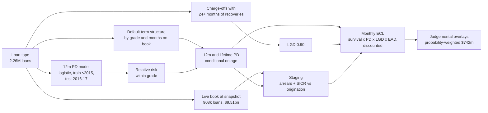
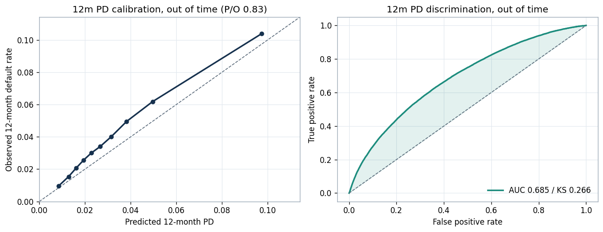
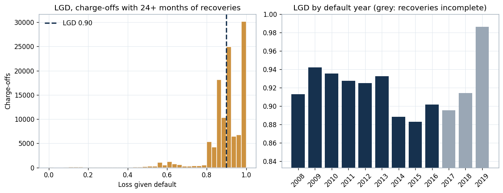
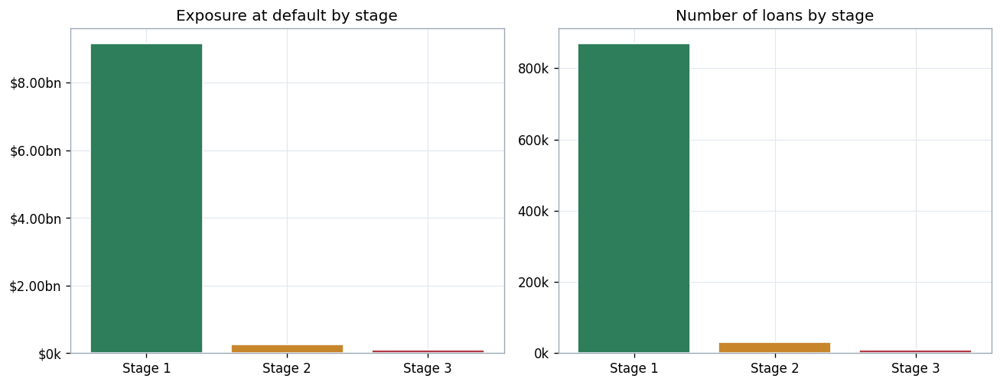
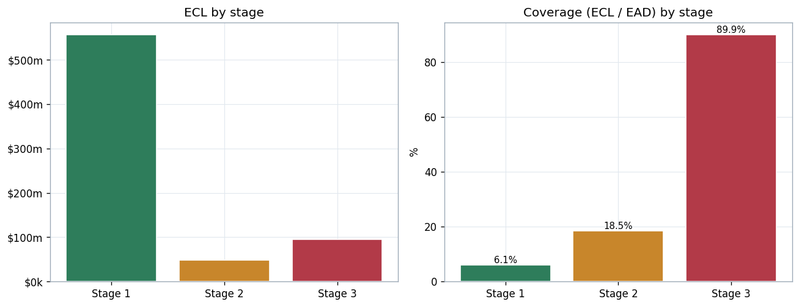
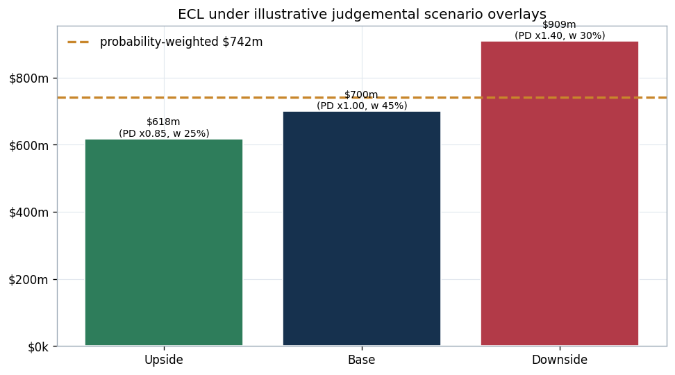
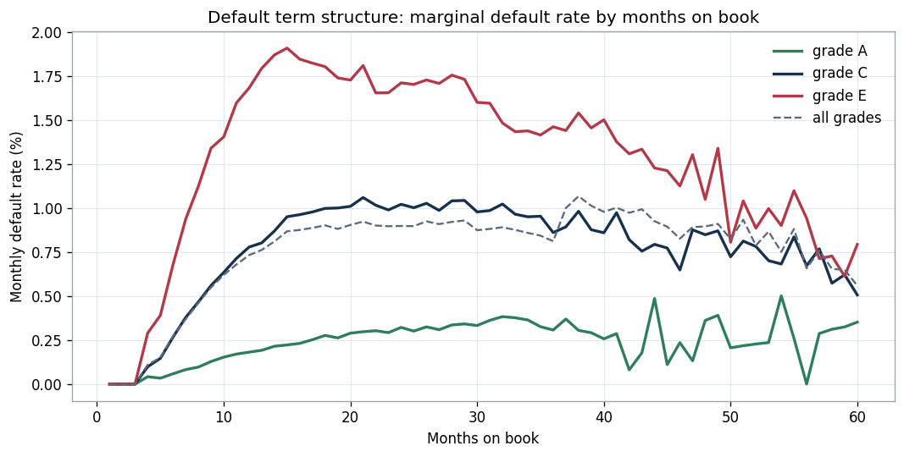
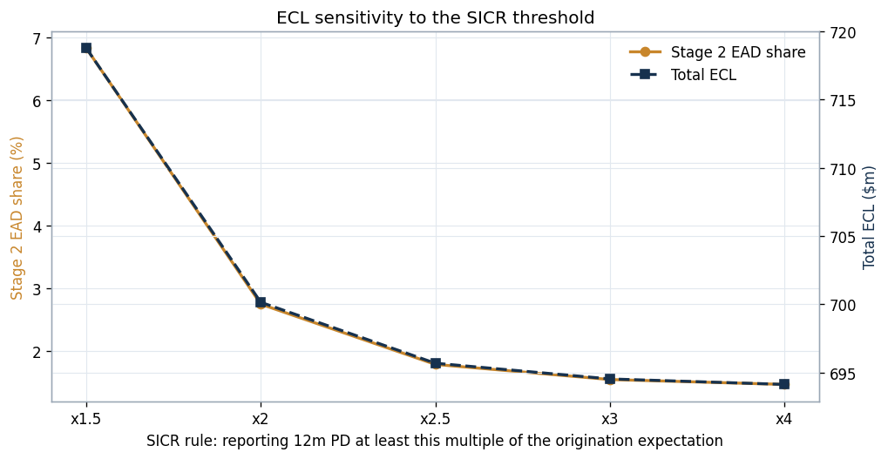

# IFRS 9 Expected Credit Loss (ECL) Engine

**An end-to-end IFRS 9 impairment calculation on a real loan book: 12-month and lifetime PD from an empirical default term structure, LGD from matured recoveries, an amortising EAD, three-stage staging with a SICR test against origination, and judgemental scenario overlays.**

This project builds the calculation that sits at the centre of credit risk in a regulated lender: the expected credit loss a lender must hold against its loan book under IFRS 9. It estimates each parameter from the Lending Club loan tape (2.26M loans), stages the 907,904 loans still live at the data snapshot (March 2019), computes the allowance month by month over each loan's remaining schedule, and tests how much it depends on the judgements a reviewer would challenge. Amounts are US dollars.

---

## Why this matters

Under IFRS 9, a lender recognises an expected credit loss from day one, built from three parameters and a staging rule:

- **PD**, probability of default
- **LGD**, loss given default
- **EAD**, exposure at default
- **Staging**: Stage 1 (performing, 12-month ECL), Stage 2 (significant increase in credit risk, lifetime ECL), Stage 3 (credit-impaired, lifetime ECL)

The allowance drives the impairment charge, capital and what is reported to the regulator. This project implements the whole chain and makes each judgement visible.

---

## Headline results

The live book at the March 2019 snapshot: **907,904 loans** and **$9.51bn** of outstanding principal.

| Stage | Meaning | Loans | EAD | ECL | Coverage |
|------:|---------|------:|----:|----:|---------:|
| 1 | Performing (12-month ECL) | 868,686 | $9,143m | $556m | 6.1% |
| 2 | Significant increase in credit risk (lifetime ECL) | 29,999 | $261m | $48m | 18.5% |
| 3 | Credit-impaired (balance x LGD) | 9,219 | $107m | $96m | 89.9% |
| **Total** | | **907,904** | **$9,510m** | **$700m** | **7.4%** |

Coverage rises across the stages (6.1% to 18.5% to 89.9%), the IFRS 9 pattern. Stage 1 coverage is high by bank standards because this is unsecured lending to near-prime borrowers: the average forward 12-month PD in Stage 1 is about 9% and LGD is about 0.9.

**Parameters.** 12-month PD model: out-of-time AUC **0.685** (Gini 0.370, KS 0.266) on 759,338 loans issued 2016-2017. LGD **0.90** from 114,333 charge-offs with at least 24 months of recoveries (0.91 across all 269,338 charge-offs, which over-states it because recent ones are still recovering).

**Scenarios.** Illustrative judgemental PD overlays (x0.85, x1.00, x1.40, weighted 25/45/30) give **$618m**, **$700m** and **$909m**, a probability-weighted allowance of **$742m**. These are not from a macroeconomic model.

**Judgement sensitivities.**

| Judgement | Range of total ECL |
|---|---|
| Staging of loans 31-120 days late: all Stage 2 / base (3+ months unpaid in Stage 3) / all Stage 3 | $630m / $700m / $797m |
| SICR multiple: x1.5 / x2 (base) / x4 | $719m / $700m / $694m (Stage 2 share of EAD 6.8% / 2.7% / 1.5%) |

Every number above is in [`results.json`](results.json).

---

## Method



**Default definition.** The file has no month-by-month delinquency history, so a charged-off loan's default is dated at its last payment plus four months (about 90 days past due).

**12-month PD model.** A logistic regression on application data (FICO, debt-to-income, income, payment-to-income, loan-to-income, term, employment length, revolving utilisation, delinquencies, enquiries, accounts, credit history, home ownership, purpose, verification) predicts default within 12 months of issue. It is trained on loans issued up to 2015 and tested on 2016-2017 issues, using only loans whose 12-month window had passed by the snapshot. Lending Club's own grade and interest rate are excluded as features. Out of time it ranks well but under-predicts the level (predicted / observed 0.83), so it is used only to rank borrowers within a grade.

**Default term structure.** For each grade, the monthly default rate by months on book is measured directly: defaults in the month divided by loans still on book at its start, with loans leaving when they default, repay or reach the last observable month. This sets the PD level and shape (default risk climbs through the first year and stays near its peak through the second and third). Each live loan's relative risk (its model PD over its grade's average) scales its grade's curve, and PD is computed from the loan's current age forward, so a loan that has already survived two years is not charged for its first-year risk again.

**SICR.** The same calculation is run with origination data to get the 12-month PD expected at origination for a loan of the current age, and with the borrower's latest FICO to get the PD at the reporting date. A loan moves to Stage 2 if the reporting PD is at least twice the expected PD and at least 1 point higher, or if it is 31+ days past due (the backstop). 17,737 loans are in Stage 2 on the PD test alone.

**Stage 3.** Lending Club's "Default" status (121+ days past due), plus loans 31-120 days late whose last payment was three or more months before the snapshot (treated as 90+ days past due).

**LGD.** For each charge-off, `LGD = 1 - net recoveries / principal outstanding at default`. Only charge-offs dated at least 24 months before the snapshot are averaged, because recoveries keep arriving for years. LGD is applied by loan term.

**EAD and ECL.** Each loan's balance follows its contractual amortisation. ECL sums, month by month, survival x monthly PD x LGD x scheduled balance, discounted at the loan's interest rate: the first 12 months for Stage 1, the remaining life for Stage 2, and balance x LGD for Stage 3.

---

## Figures, with interpretation

**PD validation.** 
Out of time, the 12-month PD model ranks loans reasonably (AUC 0.685, right) but every decile sits above the diagonal (left): 2016-2017 borrowers defaulted more than the model, trained on earlier loans, expected. That is why the level comes from the observed term structure rather than from the model.

**Loss given default.** 
LGD clusters near one: unsecured recoveries average about 10% of the balance at default. The right panel shows why recent charge-offs are excluded: their recoveries are incomplete (grey), and the 2018 and 2019 defaults show LGD close to one because little has been recovered yet. A secured book, such as vehicle finance, would show a much lower and more dispersed LGD.

**Staging the book.** 
Almost all exposure is Stage 1. Stage 2 is 2.7% of EAD under the base SICR rule, which is strict by industry standards; the SICR sensitivity below shows what a looser rule does.

**ECL and coverage by stage.** 
Coverage climbs from 6.1% in Stage 1 to 18.5% in Stage 2 and 89.9% in Stage 3.

**Scenario overlays.** 
The allowance under the three judgemental PD overlays and their probability-weighted result ($742m). A production model would derive scenario PDs from macroeconomic forecasts.

**Default term structure.** 
Monthly default rate by months on book for grades A, C and E and for the whole book. Defaults are near zero for the first three months by construction (default is dated four months after the last payment), climb through the first year, stay high through the second and third, then ease.

**SICR sensitivity.** 
Loosening the SICR test from x2 to x1.5 moves Stage 2 from 2.7% to 6.8% of EAD and total ECL from $700m to $719m. The allowance is not very sensitive to this judgement here, because Stage 2 lifetime coverage is only about three times Stage 1 coverage on this short-dated book.

---

## How a second line would challenge this

- **Is the PD calibrated, not just discriminating?** The out-of-time calibration is shown; it under-predicts, so the level is taken from observed default rates instead.
- **Is lifetime PD consistent with how long loans have already been on book?** Yes: PD is conditional on survival to the current age.
- **Is SICR measured against origination?** Yes, loan by loan, at the same months on book, with the threshold's effect quantified.
- **Is LGD measured or assumed?** Measured from recovery cash flows, restricted to charge-offs with complete recoveries, with the population size stated.
- **Are the scenarios defensible?** They are labelled as judgemental overlays, not presented as a macroeconomic model.
- **Where are the biggest judgements?** The staging of loans 31-120 days late moves the allowance by -10% to +14%; that is the one to discuss first.

---

## Limitations

- **PD does not use current arrears.** The model and term structure use application data, age and grade, not whether a loan is behind today. Loans 31-120 days late that stay in Stage 2 are probably under-provided; the staging sensitivity shows the range.
- **Scenario overlays are judgemental**, not linked to unemployment or GDP forecasts.
- **No prepayment in EAD.** Balances follow the contractual schedule; many of these loans repay early, so lifetime ECL is somewhat overstated.
- **LGD ignores recovery timing.** Recoveries are not discounted to the default date, which slightly understates LGD.
- **One snapshot.** There is no movement between reporting dates, and the term structure pools 2007-2018 vintages, mostly a benign US credit period.
- **US unsecured consumer lending.** The method transfers to an auto or captive-finance book, but a secured book would have a much lower LGD and EAD would reflect any balloon or residual value.

Treat the dollar allowance as a first-order figure on public data. The structure (rising coverage by stage, high unsecured LGD, and where the judgements bite) is the point.

---

## Run it

```bash
pip install -r requirements.txt
# download accepted_2007_to_2018Q4.csv.gz from Kaggle into data/raw/ (or set LENDING_CLUB_CSV to its path)
python analysis.py        # all figures, results.json and data/scored_portfolio_sample.csv (about a minute)
pip install jupytext nbclient ipykernel && python make_notebook.py   # optional: rebuild the notebook
```

The notebook is generated from `analysis.py` (written in notebook cell format) and executed, so the two always match.

## Repository structure

```
.
├── analysis.py                 # PD / term structure / staging / LGD / EAD / ECL / scenarios (cells marked for the notebook)
├── ifrs9_ecl_engine.ipynb      # generated from analysis.py and executed
├── lending_club.py             # shared loader: outcome windows, snapshot, default dating
├── make_notebook.py            # converts analysis.py to the notebook and runs it
├── results.json                # every number quoted above
├── CHANGES.md                  # what changed and why, with old and new numbers
├── figures/                    # seven generated charts
├── data/
│   └── scored_portfolio_sample.csv   # 50,000-loan sample of the staged, scored live book
├── requirements.txt
├── LICENSE
└── README.md
```

## Data licence

The **code** is released under the MIT License (see `LICENSE`). The underlying **Lending Club** loan data (accepted loans 2007-2018, via Kaggle) is publicly available and used here for a non-commercial portfolio project; it is not redistributed here and remains subject to its own terms.
